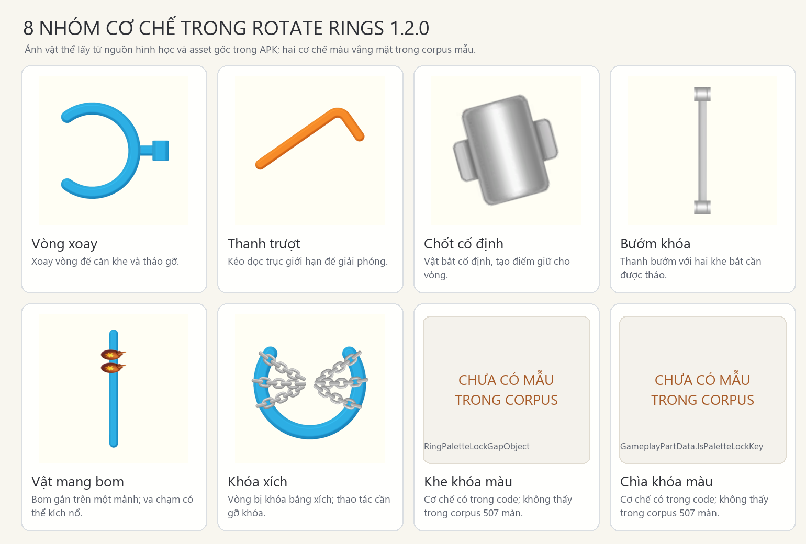
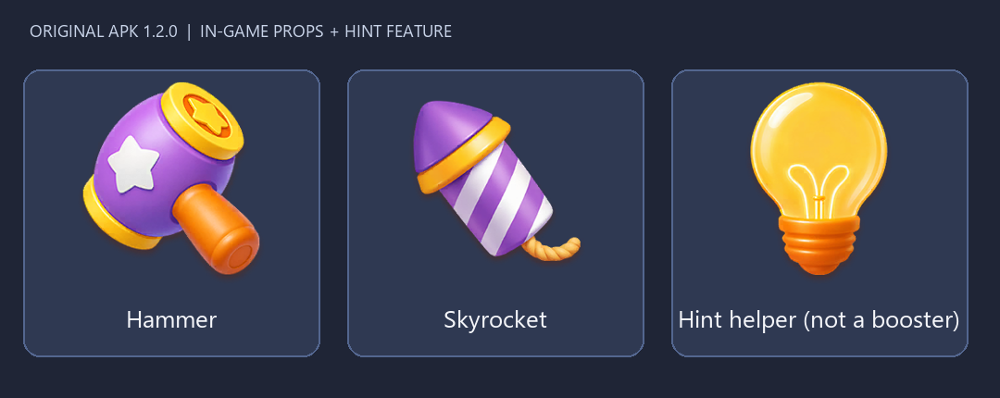

# Rotate Rings 1.2.0: elements and boosters

**Scope:** original `Rotate_Rings_1.2.0_APKPure.apk`, checked against decompiled C# and source assets.

## Counts

- **8 gameplay element families** in the APK code: Ring, Pull/sliding stick, Fixed catch, Butterfly catch, Bomb carrier, Chain lock, Palette lock gap, and Palette key. Bomb and locks are mechanics/modifiers, not extra movable shapes.
- **6 of those families appear in the checked 507-layout corpus subset** (ordinary 460 + novelty 47). Palette lock and Palette key are implemented in the APK but each has zero occurrences in that subset.
- **2 consumable in-game boosters:** Hammer and Skyrocket. `EPropType` assigns IDs 201 and 202. `PropModelProxy.GetInGamePropConfigs` admits IDs 200–299, and `RotateRingPropUseService` registers handlers for these two.
- **Hint is a separate helper, not a consumable booster:** `RingHintService.ShowHint()` exists and the original prop bundle has a Hint sprite, but `EPropType` and the prop handler registry have no Hint entry. Undo is not represented in the inspected prop enum/handler registry.

## Element images

The six pictures were rendered from source fixture part definitions through `RotateRingsWorldView` using recovered source templates and original material/catch visuals. Each thumbnail is isolated on an offscreen camera; the live board was not changed. The two palette mechanic cards deliberately have no invented artwork. Their presence is code-confirmed only.

## Booster images

**Hammer (APK gốc):** người chơi tap một mảnh chưa giải để dùng búa. Ring và Pull hỗ trợ remove-mode, còn `FixedObject` để trống các hàm này, nên chốt cố định và bướm không phải mục tiêu búa. Xem `RotateRingPropUseService.cs` 175–218, `RingObject.cs` 2232–2252, `PullObject.cs` 233–252, và `FixedObject.cs` 116–126.

**Skyrocket (APK gốc):** game tự chọn đích Ring/Pull chưa giải; đích đã dành cho rocket khác hoặc bị loại khỏi cascade sẽ bị bỏ qua. Chính sách chọn phụ thuộc `PropFunction.SkyrocketTargetChoose`: chế độ mặc định chọn ngẫu nhiên trong các mảnh `RandomBombCanSelect`; chế độ ưu tiên chọn ngẫu nhiên trong nhóm ưu tiên cao nhất còn đích. Khi tới đích, rocket gọi hammer-remove. Xem `SkyrocketTargetSelector.cs` 12–23, 45–100, 103–179 và `RocketPropHandler.cs` 406–415, 432–502.

Hint highlights/suggests a move and is outside the consumable booster count.

## Mechanics from original code (Vietnamese notes)

- **Vòng xoay:** `RingObject` xoay theo thao tác người chơi; `LockCount > 0` khiến vòng bất động. Khe, màu và kích thước không tạo thêm nhóm.
- **Thanh trượt / Pull:** di chuyển dọc theo trục đã định. Các hình thẳng/gấp khúc là hình học/template của cùng `PullObject`; code không có enum gốc đếm riêng số dáng.
- **Chốt cố định:** được giải khi điều kiện catch-guide của phần đang mắc vào guide thỏa mãn. Đây là một guide; bướm có hai slot riêng.
- **Bướm:** vật cố định gồm một bridge và hai slot-catch. Bướm được giải nếu có ít nhất một slot-guide đang giữ một phần, và mọi slot đang giữ đều thỏa điều kiện catch-guide để giải. Cơ chế này không phải vòng có thể xoay.
- **Vật mang bom:** `HasBomb` đánh dấu Ring/Pull host. Khi collider bom chạm/overlap, code gom các Ring/Pull/Fixed chưa giải đang chồng lấn. Nếu không có mục tiêu ngoài host, bom không nổ; nếu có, các mục tiêu đó, host mang bom và bom đều được giải. Vùng nổ do collider/shape nguồn quyết định; code không đưa ra một bán kính số cố định.
- **Khóa xích:** vòng có `LockCount > 0` không thể xoay. Sau khi một đối tượng không phải `FixedObject` được giải, mỗi đối tượng đang bị xích khác giảm bộ đếm 1; đối tượng vừa giải được đặt về 0. Giải chốt cố định/bướm không làm giảm bộ đếm xích.

Các điểm trên được đối chiếu với decompile ở `BombRelative.cs` 132–179, 264–365, 377–435; `RingLockChainService.cs` 702–708, 753–863; `CatchButterflySolver.cs` 17–73; `FixedButterflyObject.cs` 30–60, 83–123; `FixedButterflyMeshPart.cs` 9–12; `CatchGuideSolveBase.cs` 21–67; `RingObject.cs` 2571–2587; và `GameplayPartData.cs` 18–48. Mỗi file cùng SHA-256 được liệt kê trong `catalog.json`.

**Phân biệt với clone:** trong clone đang dùng cho playtest, `RotateRingsRuntime.Firework()` xóa phần đầu tiên chưa giải trong danh sách rồi chạy cascade (`RotateRingsRuntime.cs` 182–192). Đây là shortcut triển khai của clone, không phải cách Skyrocket gốc chọn đích. Bản mô tả Skyrocket ở trên chỉ nói về APK gốc.

## Counting rule and source references

Count distinct source-backed mechanics/object families, not geometry silhouettes, colors, material styles, or individual level instances. Pull remains one family because the recovered source establishes `PullObject` but no canonical enum/count for straight, L, or U silhouettes. Palette lock and its key count separately because they have distinct source flags/roles. This is an APK 1.2.0 inventory; it does not claim every family appears in every stage.

Source paths, line references, and SHA-256 values are recorded in [`catalog.json`](catalog.json). Principal definitions: `Research/rules/decompiled/RotateRings.Prop/EPropType.cs` lines 3–9; `PropModelProxy.cs` lines 48–77; `RotateRingPropUseService.cs` lines 44–54; `RingObject.cs` line 13; `PullObject.cs` line 11; `FixedObject.cs` line 6; `FixedButterflyObject.cs` line 9; `RingPaletteLockGapObject.cs` line 10; and `GameplayPartData.cs` lines 18–48.
